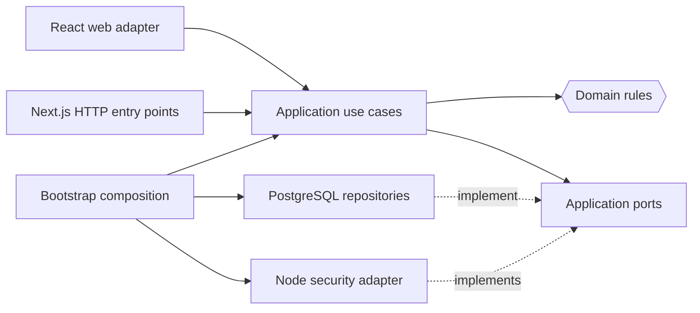

# Hexagonal architecture

The workshop separates business behavior from transport, storage and cryptography. Dependencies point toward the domain and application. The composition root selects concrete adapters.

```text
src/
├── domain/                        Business rules, state and seeded scenario
├── application/
│   ├── ports/                     Storage and security contracts
│   └── use-cases/                 Authentication, workshop operations, reports
├── adapters/
│   ├── inbound/
│   │   ├── http/                  Cookie/origin policies and response presenters
│   │   └── web/                   React components and browser localization
│   └── outbound/
│       ├── persistence/postgres/  SQL repositories, transactions and pool
│       └── security/              Node cryptography implementation
├── bootstrap/                     Dependency composition and runtime settings
├── shared/i18n/                   Pure copy shared by web and HTTP presenters
└── app/                           Next.js routes, layout and global styles
```



## Responsibilities

- `domain` owns order/intervention transitions, stock and costing rules, equipment observations and the deterministic policy comparison. It imports no framework, database driver or adapter.
- `application/use-cases` coordinates those rules, ownership, authorization projections, idempotency, login attempts, session lifetimes and report records. It depends on ports, domain types and deterministic request validation; it contains no SQL, HTTP objects, React or environment reads.
- `application/ports` defines operations in workshop language rather than exposing SQL or `PoolClient`. Transaction units require one connection and a locked scenario for state, receipt and audit writes.
- Outbound adapters implement the contracts. PostgreSQL supplies row/advisory locks, durable transactions and database-relative expiration timestamps. Node supplies cryptographic hashing, random identifiers, tokens and password verification.
- Inbound HTTP policies interpret cookies and origin headers; presenters convert records/errors into CSV/JSON-facing values. React consumes application view types rather than importing persistence code.
- `bootstrap/services.ts` is the composition root: it constructs repositories, injects the security adapter and reads signup settings. Nothing inside the domain or application selects a concrete database.
- `app` remains at its conventional Next.js path. Its routes are framework entry points. The static design-asset route is a technical file server outside the workshop use cases.
- `shared/i18n` holds pure translations used by web and HTTP presentation. Business rules do not depend on display language.

## Following an operation

An HTTP command authenticates the cookie through the authentication use case. The workshop use case opens the repository transaction port, loads a workspace-owned scenario under a row lock, checks its command receipt, applies the domain command, and saves state, audit and receipt through that same unit. A PostgreSQL failure rolls the complete unit back. The presenter and framework then send the response.

Reports follow a separate path: the use case returns authorized raw rows; the HTTP CSV presenter applies language and formula-safe escaping. CSV strings are not generated in the application core.

## Verification and changes

Run `npm test` for domain, application, presentation and dependency-boundary checks. The application tests inject in-memory ports to check replay, rollback, ownership, redaction, provisioning, lockout, logout and idempotent seeding without PostgreSQL. The fakes are test helpers, not a production persistence option.

`tests/architecture.test.ts` scans static and dynamic imports and rejects forbidden dependency directions. Production HTTP integration tests separately verify actual PostgreSQL concurrency, rollback, authentication, reports and atlas routes. Run `npm run test:integration` against the launched application.

No schema migration, data reset, credential change or API URL change is needed for this reorganization. The application still starts with `npm start`. Historical model files remain under `docs/models`; generator tools and launch scripts retain their documented entry points.
